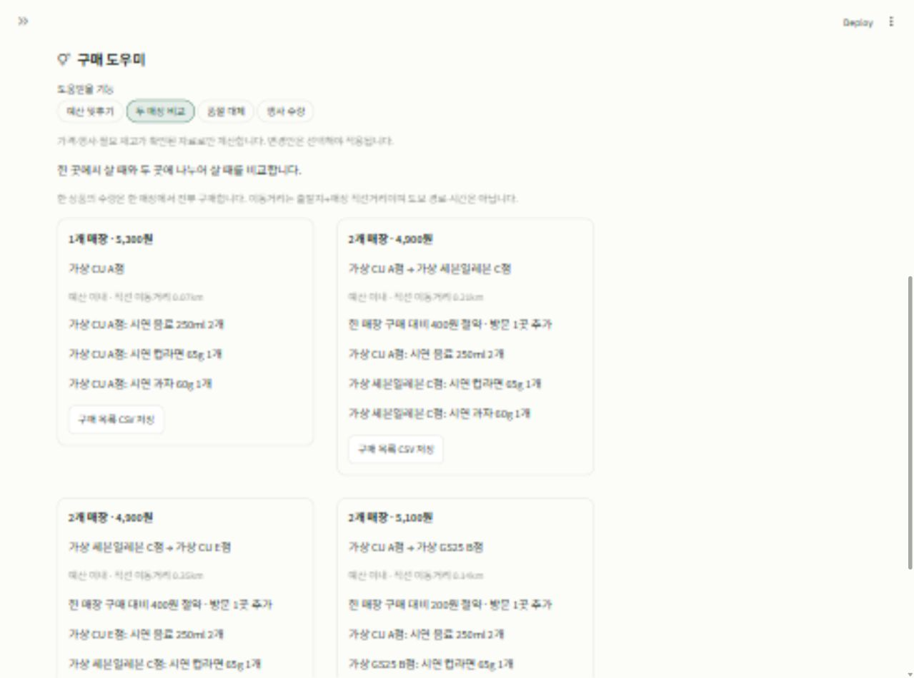

# 편의점 장바구니 v2

컴퓨팅 실습 기말 과제로 만든 Python·Streamlit 앱입니다. 중간 과제의 편의점 재고·행사 조회를 바탕으로, 필요한 상품을 어디서 어떤 수량으로 사면 좋을지 비교합니다.

v1의 사진 검색·장바구니 비교에 **예산 맞춤 수량 조정, 두 매장 나눠 구매, 대체품 제안, 행사 수량 안내**를 추가했습니다. 공개 웹 서비스로 배포하지 않고 로컬에서 실행합니다.

## 버전 선택

| 브랜치 | 내용 | 기본 실행 포트 |
| --- | --- | --- |
| [main](https://github.com/JHBAE003/convenience-store-basket/tree/main) | 원래 v1 유지 | 8502 |
| [v1-stable](https://github.com/JHBAE003/convenience-store-basket/tree/v1-stable) | v1 보관용 브랜치 | 8502 |
| [v2](https://github.com/JHBAE003/convenience-store-basket/tree/v2) | 네 가지 구매 도우미 추가 | 8503 |

로컬에서도 기존 `기말 과제` 폴더는 v1 그대로 두고 `기말 과제 v2` 폴더에서 개발했습니다. 9주차 실습 앱과 [my-streamlit-app](https://github.com/JHBAE003/my-streamlit-app)은 별도입니다.

## v2에서 추가한 기능

### 예산 맞춤 수량 조정

장바구니에서 **예산 조정에서 수량 유지**를 체크한 상품은 원래 수량을 유지합니다. 나머지 상품은 수량을 줄이거나 제외해 예산 안의 구매안을 찾습니다.

추천은 줄이는 개수 최소, 변경 상품 수 최소, 낮은 결제액 순입니다. 상품의 주관적인 중요도나 영양 가치를 추측하지 않습니다. 빈 장바구니는 제안하지 않으며, 적용 버튼을 누르기 전에는 원래 장바구니를 바꾸지 않습니다.

### 한 매장과 두 매장 구매 비교

한 곳에서 전체 상품을 살 때와 두 곳에 나누어 살 때의 총액·방문 매장 수·구매 목록을 비교합니다. 한 상품의 수량은 한 매장에서 전부 구매하며, 증정 행사는 매장별로 따로 계산합니다.

최대 10개 매장과 상품 5종의 조합 안에서 계산합니다. 제시한 이동거리는 출발지→매장 A→매장 B의 **직선거리**이고, 돌아오는 거리·도보 경로·이동시간은 포함하지 않습니다. 정확한 좌표를 확인하지 못한 조합은 전체 이동거리 미확인으로 표시합니다. 예산을 넘는 한 매장 구매안도 비교 기준으로 보여줍니다. 구매 목록은 CSV로 저장할 수 있습니다.

### 품절 상품의 대체품 제안

원상품과 대체 후보의 종류·용량·단위, 추가 지출 한도를 확인하고 후보의 재고·가격을 비교합니다. 시연 모드는 미리 작성한 가상 상품 분류표를 사용합니다.

실시간 모드에서는 대체 상품명을 따로 검색한 뒤 후보 하나를 선택하고, 제품 표시를 보고 원상품·대체품 용량과 단위를 입력합니다. **같은 종류와 입력 용량이 맞다는 확인을 해야** 적용 버튼이 나타납니다. 후보나 용량을 바꾸면 해당 조합을 다시 확인해야 합니다. 실제 상품의 분류·알레르기·영양 특성을 이름만 보고 자동 추측하지 않습니다.

원상품 가격이나 행사 조건이 미확인이면 추가 지출 한도를 계산할 수 없어 대체품을 확정 제안하지 않습니다. 교체 후에는 선택한 대체 상품의 브랜드·코드를 기준으로 매장 재고를 다시 비교합니다.

### 행사에 맞는 수량 안내

1+1·2+1 묶음을 채우는 다음 수량과 추가 결제액을 보여줍니다. 예를 들어 개당 1,200원인 2+1 상품은 2개와 3개 모두 2,400원입니다. 추가 금액이 있는 제안은 그 금액도 표시합니다. 매장 재고와 상품별 10개 상한을 넘는 수량은 제안하지 않습니다.

## 실행

확인한 환경: Python 3.14.7, Streamlit 1.65.0, pandas 2.3.3, requests 2.34.2, Pillow 12.3.0. 비공개 저장소이므로 GitHub 로그인이 필요합니다.

Windows PowerShell:

```powershell
git clone --branch v2 https://github.com/JHBAE003/convenience-store-basket.git convenience-store-basket-v2
cd convenience-store-basket-v2
python -m venv .venv
.\.venv\Scripts\python.exe -m pip install -r requirements.txt
.\.venv\Scripts\python.exe -m streamlit run streamlit_app.py --server.address 127.0.0.1 --server.port 8503 --browser.gatherUsageStats false
```

설치 후에는 `로컬 실행.bat`를 더블클릭할 수 있습니다. 실행 파일은 폴더의 `.venv`, 기존 `streamlit_env`, 현재 `python` 순서로 환경을 찾습니다. 종료는 실행 창에서 `Ctrl+C`입니다.

v1을 별도 폴더에서 사용하려면 다음과 같이 내려받습니다.

```powershell
git clone --branch v1-stable https://github.com/JHBAE003/convenience-store-basket.git convenience-store-basket-v1
```

v1 폴더의 안내에 따라 8502 포트로 실행하면 v2와 함께 사용할 수 있습니다.

## 화면 미리보기



[작은 화면의 구매 도우미](assets/screenshots/v2-mobile.png)

## 네 기능을 바로 시연하기

1. 왼쪽 데이터 모드에서 **시연용 데이터**를 선택합니다.
2. **v2 시연 상황**에서 원하는 기능을 고르고 **상황 불러오기**를 누릅니다.
3. **구매 도우미**에서 추천안과 근거를 확인합니다.
4. 수량·대체품을 적용하면 이전 비교는 지워집니다. **매장 비교하기**를 다시 눌러 새 결과를 확인합니다.

| 상황 | 확인할 내용 |
| --- | --- |
| 예산 맞추기 | 예산 4,000원, 컵라면 수량 유지 → 과자를 제외하는 A점 3,300원 구매안 |
| 두 매장 비교 | 한 매장 5,300원과 A점 음료 + C점 컵라면·과자 4,900원 비교 |
| 품절 대체 | C점 원래 음료 재고 1개 → 필요한 2개를 살 수 있는 가상 대체 음료 조회·선택 |
| 행사 수량 | A점 음료 1개 → 추가 결제 없이 2개로 변경 |

시연 상품·매장·재고·가격은 모두 가상입니다. v2 시연 CSV의 처음 18개 관측은 v1과 같고, 대체 상품 관측 12개를 추가했습니다. 원래 예시 장바구니의 A점 5,300원·B점 6,500원도 유지됩니다.

## 사진 검색과 데이터 기준

첫 화면은 CU 공식 상품 사진 12종을 저장한 둘러보기 목록입니다. 이름을 입력하고 Enter를 누르거나 입력창 밖을 클릭하면 목록을 거릅니다. 목록에 없는 상품은 **실시간 상품 검색**으로 조회합니다. 사진 출처와 수집 날짜는 `sample_data/photo_catalog.json`에 기록했습니다. 사진 목록의 참고 가격은 현재 점포 재고·행사·최종 결제액이 아닙니다.

사진이 없거나 연결에 실패해도 상품명과 담기 기능은 유지합니다. 가상 시연 상품에는 실제 제품 사진을 붙이지 않습니다. 조회 실패를 시연 데이터로 자동 대체하지 않습니다.

v2의 실시간 확정 추천은 가격·재고·행사가 LIVE로 확인되고 각 관측 시각이 5분 유효 범위 안인 경우에 한합니다. 저장·부분 실패·자료 충돌·수량 미확인 자료는 확정 추천에서 제외합니다. 시간대 없는 실시간 시각도 확정하지 않습니다. 시연 자료는 TEST로 구분하고 고정 시각을 사용합니다. 방문 시점의 재고를 보장하지 않으므로 구매 전에 매장에서 다시 확인해야 합니다.

## 구현과 검증

핵심 계산은 Streamlit 화면과 분리한 Python 서비스입니다. 예산 계산은 수량별 비용을 미리 확인하고 제한된 조합을 탐색합니다. 두 매장 비교는 상품별 전체 수량의 배정을 열거하고 매장별 행사 비용을 합산합니다. 대체품은 명시적 상품 대응표 또는 사용자 확인 메타데이터를 사용합니다.

```powershell
python -m unittest discover -s tests -v
python -m compileall -q core streamlit_app.py
python -m pip check
```

자동 검사는 외부 응답을 모의 처리하며, 실제 모든 브랜드의 실시간 조회 성공을 보증하지 않습니다. 새 가상환경에서 의존성을 다시 설치하는 검증과 공개 배포는 별도로 수행하지 않았습니다. 상세 결과는 `docs/v2-verification.md`에 기록합니다.

## 주요 파일

| 파일 | 역할 |
| --- | --- |
| `streamlit_app.py` | 상품 목록·장바구니·비교 화면 |
| `core/ui/v2_panels.py` | 네 기능의 입력과 추천 결과 |
| `core/ui/v2_actions.py` | 사용자가 선택한 변경 적용·이전 결과 무효화 |
| `core/services/budget_optimizer.py` | 예산에 맞는 수량 조합 탐색 |
| `core/services/split_purchase.py` | 한 매장·두 매장 구매안 비교 |
| `core/services/substitutions.py` | 분류·용량·확인된 재고에 따른 대체품 |
| `core/services/quantity_suggestions.py` | 행사 묶음 수량 안내 |
| `sample_data/v2_demo_products.csv` | 가상 관측 30개 |
| `sample_data/substitute_catalog.csv` | 가상 상품의 명시적 분류·용량 |
| `docs/plans/2026-10-31-v2.md` | v2 구현 범위와 작업 계획 |

기존 Word 기획서와 개발 계획 문서는 v1 기획 기록으로 보관합니다. 회원·카드 할인, 교차 증정, 상품 수량의 매장 간 분할, 실제 도보 경로 계산, 사용자 계정·장기 구매 기록은 지원하지 않습니다.

## 출처

초기 사진과 참고 판매가는 [CU 공식 행사 페이지](https://cu.bgfretail.com/event/plus.do?category=event&depth2=1&sf=N)에서 확인했습니다. 제품 사진과 상표의 권리는 각 권리자에게 있습니다. 이식한 중간 과제 파일의 원본 해시는 `SOURCE_FILES.txt`에 기록했습니다.
