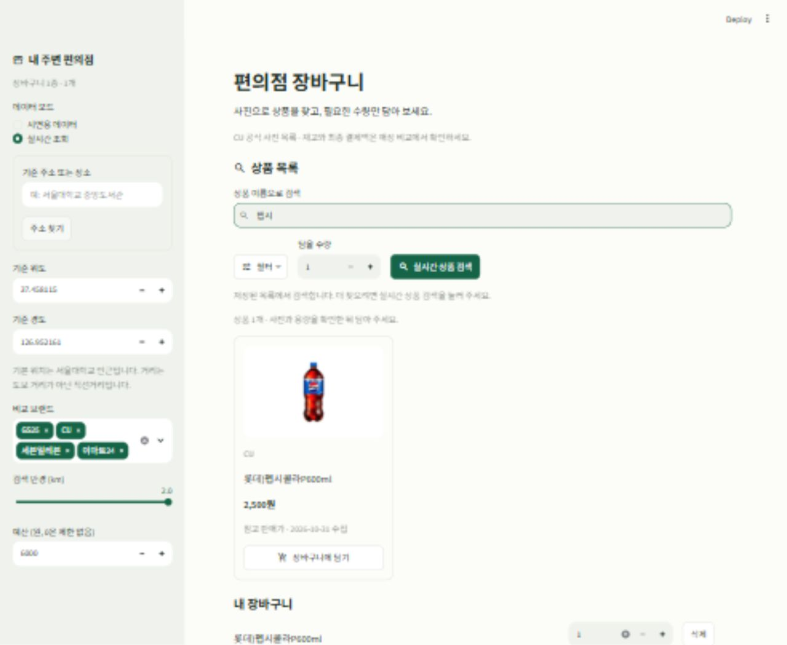

# 편의점 장바구니 비교

컴퓨팅 실습 수업의 기말 과제로 개발 중인 Python·Streamlit 앱입니다. 중간 과제에서 만든 편의점 재고·행사 조회 프로그램을 확장해, **필요한 상품을 한 매장에서 모두 살 수 있는지와 장바구니 전체의 예상 결제액**을 비교합니다.

상품별 최저가를 나열하는 데서 그치지 않고, 원하는 수량을 모두 살 수 있는 점포를 찾고 예산과 거리를 함께 비교하는 것이 목표입니다. 현재는 상품 사진 검색 UI와 로컬 장바구니 비교까지 구현한 개발 버전이며, 공개 웹 서비스로 배포하지 않았습니다.

## 중간 과제에서 확장한 내용

| 구분 | 중간 과제 | 기말 과제 |
| --- | --- | --- |
| 비교 대상 | 상품별 재고·가격·행사 | 여러 상품과 수량으로 구성한 장바구니 |
| 사용자 화면 | Python 데스크톱 앱 | Streamlit 상품 사진 목록·검색·장바구니 |
| 구매 가능 여부 | 개별 상품의 점포 재고 | 한 점포에서 전체 품목을 필요한 수량만큼 살 수 있는지 확인 |
| 추천 | 상품 단위 비교 | 예산 안에서 저렴한 매장과 가까운 매장 안내 |
| 재사용 | 재고 조회·상품 매칭·수량별 행사 계산 | 기존 로직을 재사용하고 장바구니 합산·추천을 추가 |

## 화면 미리보기



## 상품 목록과 사진 검색

첫 화면에서 상품 이름을 입력하고 Enter를 누르거나 입력창 밖을 클릭하면 저장된 상품 목록을 검색합니다. 공백과 영문 대소문자는 구분하지 않습니다. `필터`에서 브랜드와 이름순 정렬을 선택하고, 수량을 정한 뒤 사진 카드의 `장바구니에 담기`를 누릅니다.

- 기본 화면은 실시간 모드의 상품 둘러보기입니다. 첫 화면을 여는 것만으로 외부 재고 조회를 실행하지 않습니다.
- CU 공식 행사 페이지에서 수집한 실제 상품 사진 12종을 로컬에 포함했습니다. `sample_data/photo_catalog.json`에 원본 사진 URL, 출처, 수집 시각을 기록했습니다. 참고 판매가에는 수집 날짜를 표시하며 현재 재고·행사·최종 결제액으로 취급하지 않습니다.
- 목록에 없는 상품은 이름을 입력한 뒤 `실시간 상품 검색`을 누릅니다. 반환된 상품의 사진 주소를 보존하며, 정확히 같은 상품인 경우에만 포함된 사진을 재사용합니다. 사진 누락·접속 실패 시 기본 이미지와 안내문을 표시하고 검색·담기는 계속 지원합니다.
- 실시간 검색 실패나 빈 결과를 사진 목록 또는 시연 데이터로 대체하지 않습니다. 검색어를 바꾸면 이전 검색의 상품 선택 목록도 숨깁니다.
- 브랜드별 동일 상품을 묶는 기존 선택 기능은 실시간 검색 후 사용할 수 있습니다. 비교 시에는 매장 재고와 가격을 별도로 다시 조회합니다.
- 시연 모드의 가상 상품에는 실제 제품 사진을 붙이지 않습니다.

화면 디자인에는 Design Partner 플러그인을 활용했습니다. 기본 Streamlit 카드·검색·필터와 녹색 테마를 사용하며 외부 UI 라이브러리는 추가하지 않았습니다.

실행 주소는 이 컴퓨터에서만 접속 가능한 `http://127.0.0.1:8502`입니다. 저장소에 코드를 보관하는 것과 웹 서비스를 배포하는 것은 별개입니다.

## 실행

Windows에서 처음 실행할 때는 아래 명령으로 내려받고 독립된 실행 환경을 준비합니다.

PowerShell에서 실행할 수도 있습니다.

```powershell
git clone https://github.com/JHBAE003/convenience-store-basket.git
cd convenience-store-basket
python -m venv .venv
.\.venv\Scripts\python.exe -m pip install -r requirements.txt
.\.venv\Scripts\python.exe -m streamlit run streamlit_app.py --server.address 127.0.0.1 --server.port 8502 --browser.gatherUsageStats false
```

비공개 저장소이므로 내려받을 때 GitHub 로그인이 필요합니다. 설치 이후에는 **로컬 실행.bat**를 더블클릭할 수 있습니다. 실행 파일은 이 폴더의 `.venv`, 기존 `streamlit_env`, 현재 `python` 순서로 실행 환경을 찾습니다. 종료는 실행 창에서 `Ctrl+C`를 누릅니다.

2026년 10월 31일 확인 환경은 Python 3.14.7 / Streamlit 1.65.0 / pandas 2.3.3 / requests 2.34.2 / Pillow 12.3.0입니다. `requirements.txt`는 이때 확인한 패키지 버전으로 고정했습니다. 별도의 새 가상환경에서 설치까지 검증한 결과는 아닙니다.

## 먼저 시연하기

1. 왼쪽 설정에서 **시연용 데이터**를 선택합니다. 기본 위치는 서울대학교 인근으로 지정되어 있습니다.
2. **예시 장바구니 채우기**를 누릅니다.
3. 음료 2개, 컵라면 1개, 과자 1개가 담긴 것을 확인합니다.
4. **매장 비교하기**를 누릅니다.
5. A 매장 5,300원, B 매장 6,500원과 예산 6,000원에서 잔액 700원을 확인합니다.
6. 수량이나 예산을 바꾸거나 CSV로 결과를 저장합니다.

시연 데이터의 상품·매장·주소·가격·재고는 모두 가상입니다. 6개 매장에는 정상 비교, 재고 부족, 수량 미확인, 가격 미확인, 행사 미확인 사례가 들어 있습니다. 시연 매장에는 지도 검색 링크를 제공하지 않습니다.

## 실시간 모드

실시간 모드로 전환하면 시연 장바구니를 비웁니다. 상품명을 검색한 뒤 브랜드별로 동일한 용량·맛·구성의 상품을 선택해 한 항목으로 묶습니다. 여러 브랜드의 상품을 묶을 때는 사용자가 규격을 확인해야 합니다. 브랜드 내부 상품 코드만 같다고 자동으로 연결하지 않습니다.

상품을 담은 뒤 비교하면 선택된 브랜드와 상품의 재고를 다시 확인합니다. 화면에 조회 결과와 실패 사유, 가격·재고·행사의 출처와 시각을 표시합니다.

2026년 10월 31일 로컬 점검에서는 CU의 `신라면소컵` 한 검색어로 매장 관측 12건을 받았습니다. 이 결과는 전체 브랜드나 모든 상품의 연동을 보장하지 않습니다. 해당 조회의 행사 조건은 미확인이었으므로 행사까지 확인한 최저가로 취급하지 않습니다.

## 계산과 추천 기준

- 수량은 무료 증정분을 포함해 받을 상품 수입니다. 일반 판매, 같은 상품 1+1·2+1을 기본 지원합니다.
- 회원 할인·결제수단 할인·교차 증정은 기본 계산에서 제외합니다. 지원하지 않거나 확인하지 못한 행사는 일반가 참고액으로 구분합니다.
- 모든 상품의 가격이 확인됐을 때만 총액을 표시합니다. 일부 금액은 소계, 일반가 추정이 섞인 금액은 참고액입니다.
- 재고 수량·가격·행사가 확인되고 검색 반경 안에 있는 매장만 확정 추천합니다. 재고 있음만 제공되는 자료는 정확한 수량으로 간주하지 않습니다.
- 실시간 재고 관측은 5분 범위를 확인합니다. 과거 캐시, 일부 조회 실패, 해결되지 않은 중복 자료는 보수적으로 확정 추천에서 제외합니다.
- 예산 이내 매장을 우선합니다. 최저가는 총액·거리·매장 이름순, 가까운 매장은 거리·총액순입니다. 예산 0원은 제한 없음입니다.
- 비교 범위는 최대 5종, 상품별 1~10개, 반경 0.5·1·2km, 최대 10개 매장입니다. 거리는 도보 거리가 아닌 직선거리입니다.

## 조회와 저장

재고 캐시는 5분이며 강제 재조회로 건너뛸 수 있습니다. 행사 자료는 별도의 6시간 캐시와 원래 자료 시각을 사용합니다. 오래된 행사 자료를 현재 확인된 사실로 바꾸지 않습니다.

장바구니, 조회 관리자와 임시 캐시는 사용자 세션별로 분리합니다. LIVE 실패는 TEST로 전환하지 않고 CACHE 또는 오류로 표시합니다. 임시 캐시는 장기 기록 저장소가 아니며 중간 과제의 캐시 파일을 복사하지 않았습니다.

## 검증

이 폴더에서 실행합니다.

```powershell
python -m unittest discover -s tests -v
python -m pip check
```

기존 테스트 39개와 장바구니·CSV·조회·화면 테스트가 포함되어 있습니다. 외부 서비스에 실제 요청하는 점검은 자동 테스트에 포함하지 않습니다. 화면 테스트는 `streamlit.testing.v1.AppTest`를 사용합니다.

상품 목록 추가 후 전체 자동 검사 **76개**가 통과했습니다. 마지막 화면 배치 변경 뒤에는 UI 10개와 사진·검색 처리 8개를 재검사했습니다. 브라우저에서 이름 검색·사진 표시·담기를 확인했고, 320px·768px·1280px 폭에서도 화면이 가로로 넘치지 않는 것을 확인했습니다. 모든 브랜드의 실시간 조회 성공을 보장하는 검증은 아닙니다.

## 파일 구성

| 위치 | 역할 |
| --- | --- |
| `streamlit_app.py` | 한국어 입력 화면, 장바구니와 비교 결과 |
| `core/` | 중간 과제에서 이식한 조회·매칭·계산과 새 장바구니 기능 |
| `sample_data/` | 가상 상품 관측과 명시적 브랜드별 상품 연결표 |
| `sample_data/photo_catalog.json` | 공식 사진 목록, 원본 URL, 수집 시각 |
| `assets/` | 제품 사진과 화면 미리보기 |
| `.streamlit/config.toml` | 앱 색상과 글꼴·테두리 설정 |
| `tests/` | 외부 통신을 모의 처리한 자동 검증 |
| `SOURCE_FILES.txt` | 이식한 중간 과제 파일의 원본 해시 |
| `progress.md` | 단계별 작업·검증 현황 |

기획서는 [기획서.md](기획서.md), 개발 순서와 계획은 [프로그래밍 단계와 개발 계획.md](프로그래밍%20단계와%20개발%20계획.md)에 정리했습니다. 같은 내용의 Word 문서도 포함했습니다. 상세 검증 범위는 [검증 기록.md](검증%20기록.md)를 참고할 수 있습니다.

## 현재 범위와 다음 작업

- 기본 둘러보기 사진은 CU 상품 12종입니다. 모든 편의점의 전체 상품 목록은 아닙니다.
- 외부 재고·행사 서비스의 변경이나 요청 제한으로 조회가 실패할 수 있습니다. 자료가 없거나 오래됐으면 해당 상태를 표시하며, 가상 데이터로 자동 대체하지 않습니다.
- 여러 매장을 나누어 방문하는 경로 최적화, 회원·카드 할인, 교차 증정, 사용자 계정과 장기 구매 기록은 현재 범위에서 제외합니다.
- 이후에는 공식 사진 목록의 범위를 넓히고, 브랜드별 실시간 조회와 상품 대응 정확도를 추가 점검할 계획입니다.

## 자료 출처

초기 상품 사진과 참고 판매가는 [CU 공식 행사 페이지](https://cu.bgfretail.com/event/plus.do?category=event&depth2=1&sf=N)에서 확인했습니다. 제품 사진과 상표의 권리는 각 권리자에게 있습니다. 원본 URL과 수집 시각을 함께 기록하고, 가상 시연 상품에는 실제 제품 사진을 붙이지 않았습니다.

중간 과제에서 이식한 파일의 원본 해시는 `SOURCE_FILES.txt`에 기록했습니다. 9주차 실습 저장소 [my-streamlit-app](https://github.com/JHBAE003/my-streamlit-app)은 이 기말 과제 저장소와 별도로 유지합니다.
