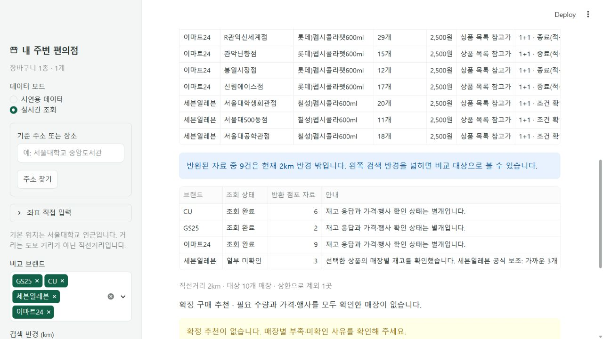

# 가격·재고·브랜드 조회 불량 수정 기록

확인일: 2026-10-31, 한국 시간. 작업 대상은 `기말 과제 v2.1`입니다. v2·9주차 원본은 유지하고 GitHub 업로드·배포는 하지 않았습니다. 이전 검증 문서의 실패 관측은 당시 결과로 보존하며, 현재 상태는 이 문서를 우선합니다.

## 원인과 수정

| 확인한 원인 | 적용한 동작 |
| --- | --- |
| GS25 선택 코드 조회에 현재 서버가 요구하는 상품명이 빠짐 | 선택 코드와 상품명을 한 재고 요청에 함께 전달. SDK 배열 오류도 원문으로 보존 |
| 이마트24 수량 목록과 점포 좌표 목록이 분리되어 있음 | 정확한 점포 코드로 좌표 결합. 위치 충돌은 보류하고 목록에만 있는 점포를 재고 0으로 만들지 않음 |
| 가격·행사 미확인이면 정상 반환 수량까지 미확인으로 가려짐 | 받은 수량·참고 가격 표를 먼저 표시. 확정 추천의 검증 기준은 유지 |
| 사진 목록은 CU뿐인데 전체 브랜드가 자동 연결된다고 보일 수 있음 | CU 사진 안내, 브랜드별 검색 상태, 미연결 표시, 기존 장바구니에 다른 브랜드 연결. 첫 후보 화면도 브랜드별로 분산 |
| 정상 반환 점포가 2km 밖인데 반경 선택 상한이 2km | 반경 밖 응답도 보여주고 현재 계산에서는 제외. 반경 선택 최대 20km |
| CU·세븐일레븐의 전체 행사 수집이 재고 표시를 지연 | 유효 행사 캐시 우선. 없으면 행사 미확인으로 반환하고 명시적 추가 확인 때만 브랜드별 최대 4페이지 요청 |
| 세븐일레븐 중계 MCP와 REST가 같은 장애를 반환 | 선택 코드 기준 공식 공개 API 직접 보조. 가까운 최대 3개 점포·범위 표시·점포 목록 캐시 |
| 행사 조건이 불명확하면 확인할 수 있는 참고 가격도 버림 | 동일 상품의 유일한 목록 가격만 REFERENCE로 보존. 상충 가격 후보를 남기고 임의 최저가를 선택하지 않음 |
| 실제 펩시 표기의 롯데/칠성·PET 접미어 차이로 수동 확인도 차단 | 해당 음료의 관측된 제조사 약칭만 수동 확인에서 정리. 자동 연결은 엄격하게 유지하고 다른 용량·맛·포장은 거절 |

같은 브랜드의 동일 명시 코드·공통 바코드는 상품명이 달라도 다른 활성 항목에 중복 연결하지 않습니다. 저장한 연결을 재사용할 때도 이미 담긴 다른 브랜드 상품이 중복되지 않게 확인합니다. 점포 원본 행사가 있으면 같은 `1+1` 표기의 브랜드 목록이 회원·카드 조건이나 출처·시각을 덮어쓰지 못하게 했습니다.

## 실제 화면 확인

실제 실행 파일로 시작한 `http://127.0.0.1:8504/`에서 **펩시 검색 → 네 브랜드 600ml 수동 확인 → 한 장바구니 항목 → 매장 비교 → 실패 브랜드만 재조회**를 수행했습니다. 기준점은 앱 기본 서울대학교 좌표이며 개인 위치를 사용하지 않았습니다.

| 브랜드 | 상품 후보 | 반환 점포 자료 | 관측 수량과 가격 |
| --- | ---: | ---: | --- |
| CU | 20개·부분 목록 | 6곳 | 13·16·10·0·0·0개. 2,500원 참고가 |
| GS25 | 16개 | 2곳 | 14·11개. 가격 미제공 |
| 이마트24 | 10개·부분 목록 | 9곳 | 19·20·25개 등을 받음. 2,500원 참고가. 9곳은 현재 2km 반경 밖 |
| 세븐일레븐 | 20개·부분 목록 | 3곳·부분 확인 | 중계 502 후 공식 직접 보조. 서울대학생회관점 20개, 서울대500동점 11개, 서울대공학관점 18개. 2,500원 참고가 |

첫 비교 완료는 23:03:44, 세븐일레븐만 다시 확인한 비교 완료는 23:18:34였습니다. **자료 응답 4/4, 조회 완료 3·일부 확인 1·실패 0·미연결 0**을 화면에서 확인했습니다. 세븐일레븐은 받은 지역 목록 32곳 중 가까운 3곳만 확인한 결과입니다. 나머지 브랜드는 기존 수신 시각을 유지하고 저장 자료 사용을 표시했습니다.

원본 재고 시각은 미제공입니다. 참고 가격과 불명확한 행사 조건을 점포 현재 결제액으로 사용하지 않았으므로 확정 추천은 보류됩니다. 실시간 실패를 시연 자료로 바꾸지 않았습니다. 단일 품목·기준점·시점의 확인이며 전 매장·다른 상품·향후 외부 서비스 정상 동작을 보장하지 않습니다.



## 요청 수와 시간의 실제 측정 범위

[화면에서 내려받은 최종 요청 기록](research/fix-live-ui-metrics-final.csv)은 상품·매장·재고 경로의 실제 HTTP 시도를 담습니다. 행사·위치 검색·이미지 요청은 이 표의 집계 대상이 아닙니다.

- 상품 후보 네 브랜드 검색: 경로별 1회, 합계 4 HTTP. 관측 응답 시간 903~2,250ms.
- 첫 전체 비교: CU 1회·GS25 1회·이마트24 1회 정상. 세븐일레븐 주 1회와 당시 REST 보조 2회는 실패. 합계 6 HTTP.
- 수정 후 **세븐일레븐만 재조회**: 주 1회 실패(1,309.91ms), 공식 보조 5회 정상(전체 보조 경로 839.60ms). 다른 세 브랜드의 HTTP는 추가 0회.
- 위 한 화면 세션의 집계는 **총 16 HTTP 시도**입니다. 자동 검사는 별도로 실제 HTTP를 차단합니다.

공식 보조의 839.60ms는 메타데이터·점포 목록·세 점포 수량을 순서대로 처리한 한 경로의 시간이며 각 요청 평균이 아닙니다. 주·보조 요청 조건과 시점이 다르므로 속도 우열이나 v2 대비 개선율의 근거로 사용하지 않습니다. 전체 사용 조건을 맞춘 v2 대비 속도 개선율은 **미측정**입니다.

조사 담당자의 추가 실제 점검은 위 화면 요청과 별개입니다. CU 2회·이마트24 2회, GS25 4회·세븐일레븐 중계 2회, 세븐일레븐 공식 직접 검증 3회를 각 문서에 기록했습니다. CU 공식 공개 화면 2회는 참고 가격·수집 구조 확인용입니다. 스키마·공개 문서 조회는 상품 재고 요청과 구분했습니다. 담당자들의 성공 응답 재생 검사는 새 실제 호출로 집계하지 않습니다.

## 세븐일레븐 공식 보조의 한계

공개 공식 앱 API의 선택 코드 메타데이터 → 지역 점포 검색 → 점포별 수량을 사용합니다. 명시적 로그인·쿠키·인증 우회·SSL 검증 해제·유료 API는 사용하지 않습니다. 주 경로 정상 시에는 공식 보조를 실행하지 않습니다.

- 한 실행은 메타데이터 1회 + 점포 목록 최대 1회 + 가까운 점포 최대 3회로 제한합니다. 목록 캐시가 있으면 최대 4회입니다. 직접 경로 자동 재시도는 0회입니다.
- 지역 점포 목록은 세션·공식 출처·정확한 좌표·행정구역별로 기존 30분 캐시를 사용합니다. 재사용할 때 만료 시각을 연장하지 않습니다.
- 수량 0은 정상입니다. 일부 실패는 확인한 점포와 미확인 점포를 구분하고, 선택 점포가 모두 실패하면 전체 재고 오류로 처리합니다. 유효한 점포 목록은 재사용하되 재고 성공으로 바꾸지 않습니다.
- 401·403·429이면 남은 점포 요청을 중단합니다. 직접 공식 출처도 향후 접근 제한이나 장애가 생길 수 있습니다.
- 메타데이터의 상품 가격은 REFERENCE이며 원본 재고 시각을 추정하지 않습니다. 최대 3곳만 조회하므로 지역 전체 최저가·전 점포 재고를 확인했다고 표현하지 않습니다.

## 자동 검사와 보존 결과

최종 전체 검사 결과를 아래에 기록합니다. 기존 시연·상품 사진·장바구니·예산·두 매장 비교·대체품·행사 수량 검사와 신규 오류 재현·복구·가격 표시·중복 연결·캐시·시각 검사를 함께 실행합니다.

**전체 294개 검사 통과, 110.702초. 모의 응답이 없는 외부 HTTP 시도 0회.** 컴파일 검사와 의존성 검사도 통과했습니다. [검사 결과 요약](research/fix-live-offline-test-result.txt)

원본 v2의 소스 98개 SHA256을 다시 대조해 변경 0개를 확인했습니다. 새 폴더에 `.git`·가상환경이 없으며 실행 파일로 시작한 8504 서버의 상태 응답도 정상입니다. [보존 확인](research/fix-live-preservation.json)

검사 명령:

```powershell
python scripts/run_offline_tests.py
python -m compileall -q core tests scripts streamlit_app.py
python -m pip check
```

UI 자동 검사는 실제 사용자의 저장 연결표와 분리했습니다. 실제로 확인한 네 브랜드 연결은 이 컴퓨터의 기존 연결표 형식으로 보존합니다. 실행 중인 브라우저 세션도 코드를 갱신할 때 장바구니·조회 자료를 유지하고 수신·원본 시각을 바꾸지 않습니다. 매장 상세 선택은 현재 조회 자료에서 다시 찾아 이전 객체가 남지 않게 했습니다.

최종 실제 화면에서 재조회하지 않은 CU 상세의 수신 시각 `23:03:35`·원본 시각 `미제공`·`앱에 저장된 자료를 사용했습니다` 표시가 함께 유지되는 것도 확인했습니다. API 재요청 없이 반경 변경과 화면 재실행을 점검했습니다.

## 세부 근거

- [CU·이마트24 응답과 좌표 문제](fix-live-2026-10-31-cu-emart.md)
- [GS25 계약·오류 원문·세븐일레븐 공식 복구](fix-live-2026-10-31-gs-seven.md)
- [참고 가격·행사 수집·수동 연결](fix-live-2026-10-31-price.md)
- [첫 화면 조회 오류](research/fix-live-ui-errors.json)
- [공식 직접 3단계 검증 원문](research/fix-seven-direct-probes.json)
- [초기 v2.1 검증 기록](v2.1-verification.md)
