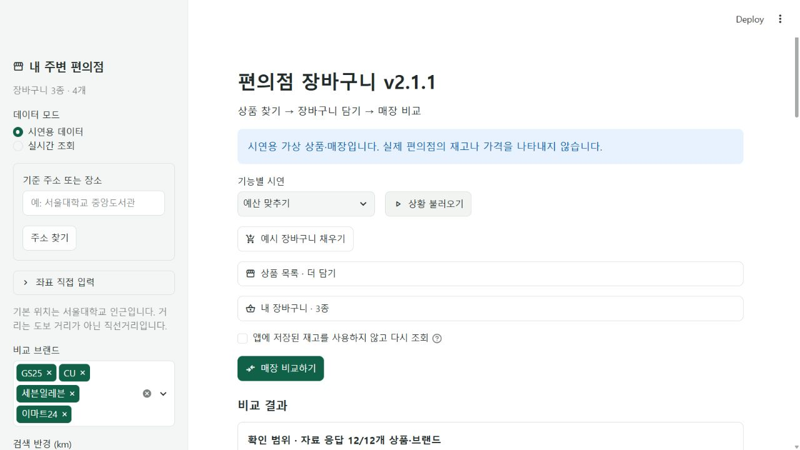

# v2.1.1 보안 변경과 검증

검증일은 2026-11-01 한국 시간입니다. v2.1 원본을 보존하고 별도 v2.1.1 폴더에서 수정했습니다. 기존 9강 소스·실행 환경·설치 패키지는 변경하지 않았으며 공개 배포는 하지 않습니다.

## 확인한 두 취약 경로

| 경로 | 실제 전제와 영향 | 수정 |
| --- | --- | --- |
| 상품 사진의 DNS 기반 blind SSRF · CWE-918 · 낮음 | 공격자가 외부 상품 응답의 이미지 URL을 조작하고 일반 호스트명을 내부 주소로 해석시킬 수 있어야 합니다. 원본의 IP 리터럴 검사는 이런 이름을 통과시켰습니다. 앱 PC에서 내부 GET이 발생하는 경로이며 임의 메서드·일반 응답 유출·인증정보 탈취는 입증하지 않았습니다. | 정확한 공급자 호스트, HTTPS443, 모든 DNS 주소의 공인 여부를 확인하고 검증한 숫자 주소로 연결합니다. 원래 호스트의 CA·인증서·SNI·Host 검증, 무프록시·무리디렉트·재시도0·크기 제한을 유지합니다. |
| 구매 목록 CSV의 수식 주입 · CWE-1236 · 낮음 | 공격자가 외부 상품·점포 이름을 통제하고 사용자가 CSV를 수식 지원 스프레드시트에서 열어야 합니다. 원본은 `=1+1` 같은 이름을 그대로 셀에 기록했습니다. 다운로드만으로 실행되지 않으며 OS 명령 실행은 입증하지 않았습니다. | 구매·비교 CSV와 표의 내장 다운로드에 공통 중화를 적용합니다. 위험 문자열 앞에 `[텍스트] `를 붙이고 공백·제어·보이지 않는 문자·전각 접두사도 처리합니다. 숫자·정상 이름·원본 모델은 유지합니다. |

독립 감사와 부모의 소스 추적이 같은 경로를 확인했습니다. 이미지 모의 재현에서 원본은 루프백 해석 후 전송 1회, 수정본은 연결 0회였습니다. 실제 내부망 요청은 하지 않았습니다. CSV는 무해한 합성 수식 문자열로 직렬화·전체 구매안 경로를 확인했으며 Excel 수식은 실행하지 않았습니다.

세부 근거:

- [이미지 경계·허용 호스트·TLS·회귀 검사](security-image-review.md)
- [구매·비교·표 CSV의 공통 중화](security-export-review.md)
- [의존성·공식 자문·설정 검사](security-dependency-review.md)

## 추가 보강

- `safe_payload`는 하이픈이 들어간 API 키·세션 키, Basic 인증, URL 사용자정보, 쿠키 문자열도 제거합니다. 실제 사용자 인증정보 유출을 발견했다고 주장하지 않습니다.
- `.streamlit/config.toml`에서도 127.0.0.1, CORS/XSRF 방어, 정적 파일 제공 끄기를 명시했습니다. 설정은 로그인 기능을 제공하는 것이 아니며 이 버전은 로컬 사용을 전제로 합니다.
- 상류가 상품 후보 요청 개수를 무시해도 앱은 20개까지만 만들고 부분 범위를 표시합니다. 전체 정제 원본 응답을 결과마다 다시 복사하지 않고 한 번 만들어 공유합니다. 원본 응답 필드는 유지하며 다른 요청·캐시 사본은 분리합니다. 이 보강을 입증된 원격 자원 고갈 취약점으로 세지는 않습니다.
- 공개 HTTP JSON/HTML 응답 전체와 모든 세션 캐시에 대한 통합 메모리 예산은 아직 없습니다. 이미지에는 별도 용량·픽셀 제한이 있고, DNS·헤더를 포함한 모든 요청이 정확히 8초 안에 끝난다는 보장은 하지 않습니다.

## 의존성 범위

[원자료](security/dependency-audit.json)는 현재 Python 3.15.2·Windows 기본 marker에 해당하는 설치 버전 35개를 기록합니다. OSV 배치 1회·PyPI 정확 버전 메타데이터 35회가 성공했고 적용 자문 ID와 조회 오류는 0개였습니다. 초기 검사에서는 직접4·간접31로 분류했고 이후 동일한 urllib3 2.8.0을 직접 의존성으로 명시했습니다. 새 패키지를 설치하거나 기존 환경을 업그레이드하지 않았습니다.

선택 extras, 모든 Streamlit 프런트엔드 npm 구성요소·네이티브 라이브러리·OS·브라우저·망 정책은 검사 범위가 아닙니다. `pip-audit`·Bandit은 미설치로 실행하지 않았습니다. 공식 자료의 미발견 결과를 알려지지 않은 취약점·공급망 변조까지 없다는 보장으로 사용하지 않습니다.

## 검사·화면·원본 보존

전체 기존 기능과 보안 회귀 검사를 외부 연결이 차단된 환경에서 실행합니다. Requests뿐 아니라 새 이미지 전송의 urllib3도 차단합니다. 실제 공식 상품 사진은 별도 1회 요청으로 정상 PNG 35,483바이트를 받았고 TLS 검증을 낮추지 않았습니다. 이 결과는 모든 공식 서버의 가용성 보장이 아닙니다.

최종 전체 **323개 검사 통과, 52.204초**, 모의 응답이 없는 HTTP 시도 **0회**입니다. 컴파일·의존성 검사도 통과했습니다. 실행 파일로 서버를 시작해 v2.1.1 제목·번들 상품 사진·시연 장바구니 3종/4개·확인 범위 12/12·예산 수량 제안을 직접 확인했습니다. 이 화면 확인에 편의점 실시간 재고 요청은 하지 않았습니다. [검사 결과](security/test-results.txt), [공식 정상 이미지 1회](security/normal-image-check.json)



```powershell
python scripts/run_offline_tests.py
python -m compileall -q core tests scripts streamlit_app.py
python -m pip check
```

의존성 재점검은 `python scripts/audit_dependencies.py`로 실행하며 패키지 이름·버전만 OSV/PyPI로 보냅니다. 실제 편의점 재고를 공격하거나 인증정보를 사용하지 않습니다.

기말 과제용 실행 포트는 8505이며 9강은 기존 8501을 유지합니다. SHA256으로 원본 v2.1의 158개 소스를 대조해 변경 0개를 확인했습니다. 새 폴더에 `.git`·가상환경·캐시·개인 상품 연결표·인증정보를 복사하지 않았습니다. GitHub 저장용 `SOURCE_FILES.txt`에는 실행 과정에서 생성된 임시 자료를 제외합니다. 이후 사용자의 명시적 승인을 받아 v2.1.1 브랜치로 저장합니다. 기존 9강과 이전 버전의 브랜치는 유지합니다.

수정 전 v2.1 자동 보고서 초안은 항목 식별자 교정 중 중복 기록이 생겨 확정하지 않고 실패 상태로 보존했습니다. 실제 발견은 위의 두 경로이며 네 개의 서로 다른 취약점이 아닙니다. 납품할 v2.1.1은 별도의 수정 후 독립 재검사에서 추가 수정이 필요한 확인된 취약점이 발견되지 않았습니다. 이 결론은 기록한 소스·테스트·자문 범위에 한정하며 표준 보고서는 Codex Security에서 별도로 확정합니다.
